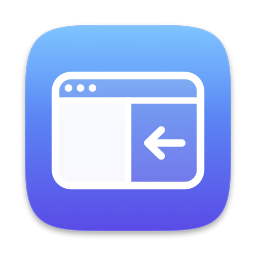
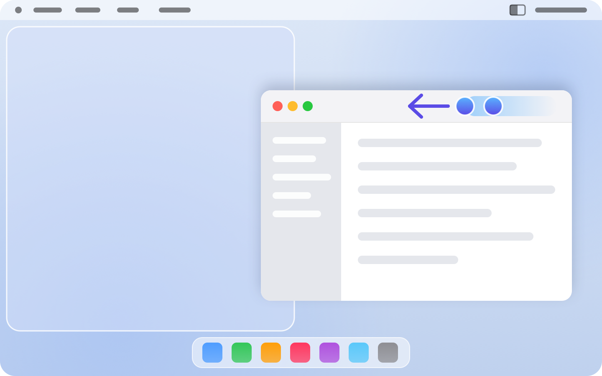
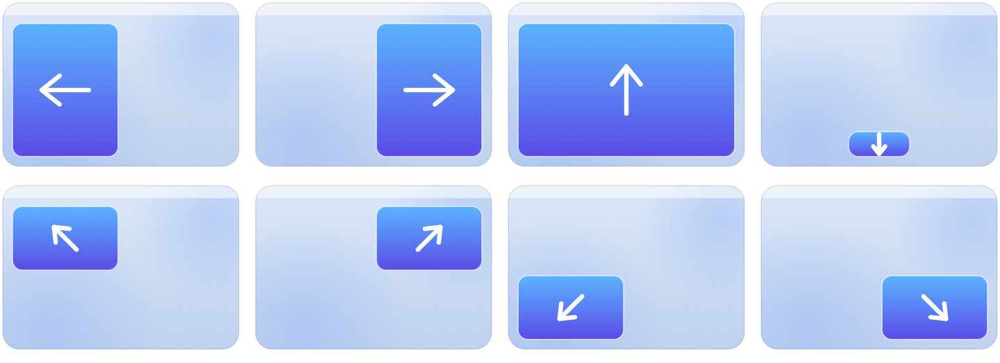

# Pane



**Window snapping for your trackpad.** Swipe on a window's title bar to snap, tile and move it. Free and open source.

A free, open-source alternative to Swish, written natively in Swift. **[panee.app](https://panee.app)** has an interactive demo.

<picture>
  <source media="(prefers-color-scheme: dark)" srcset="docs/snap-dark.png">
  
</picture>

## Gestures

Two-finger swipe on the title bar of the active window:

<picture>
  <source media="(prefers-color-scheme: dark)" srcset="docs/gestures-dark.png">
  
</picture>

| Swipe | Result |
| --- | --- |
| ← / → | Left / right half |
| ↑ | Fill the screen |
| ↓ | Minimize |
| ↖ ↗ ↙ ↘ | Quarters |
| ← / → again on a snapped window | The next monitor, or on one screen ½ → ⅔ → ⅓ |

Hold **⌥** to swipe anywhere on screen. The active window moves wherever the cursor is.

A live preview shows where the window will land, with a soft tick in the trackpad. Swipe back to cancel.

Choose **Settings** from the menu bar icon to set how long a swipe has to be, turn the preview or the haptic tick off, swipe anywhere with ⌥ and launch Pane at login.

## Install

Requires macOS 13 or later, on Apple silicon or Intel.

1. Download `Pane-<version>.dmg` from [panee.app](https://panee.app) or the [latest release](https://github.com/rokoov/pane/releases/latest), open it and drag **Pane** to Applications. A `.zip` is there too.
2. Open Pane. It isn't notarized by Apple, so macOS blocks the first launch: open System Settings → Privacy & Security and click **Open Anyway**. If you prefer the terminal: `xattr -dr com.apple.quarantine /Applications/Pane.app`
3. Grant **Accessibility** access when asked (System Settings → Privacy & Security → Accessibility). Pane needs it to read and move windows.

After an update, macOS may ask for Accessibility access again: remove Pane from the list (or run `tccutil reset Accessibility com.rokoov.pane`) and grant it again.

Releases are built by GitHub Actions straight from the tagged source and list the SHA-256 of each download.

## Build from source

```bash
git clone https://github.com/rokoov/pane.git
cd pane
./build.sh run
```

`./build.sh zip dmg` packs `build/Pane-<version>.zip` and `.dmg`. Every build is signed ad-hoc and gets a new signature, so grant Accessibility again after rebuilding, or sign with your own certificate: `SIGN_ID="Apple Development: Your Name" ./build.sh`.

Run the tests with `swift test` (needs Xcode) and check formatting with `swift format lint --strict --recursive Sources Tests Package.swift`.

## Privacy

No network access, no analytics, no accounts. Pane only listens to scroll gestures and moves windows.

## Website

The website lives in [`site/`](site) and is deployed with Cloudflare Pages.

## License

MIT
